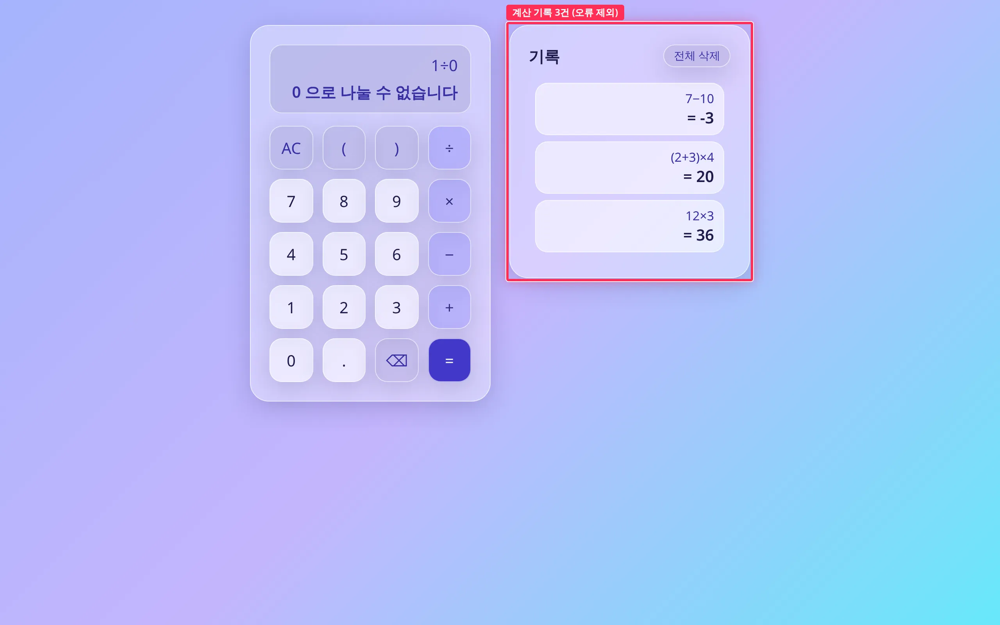
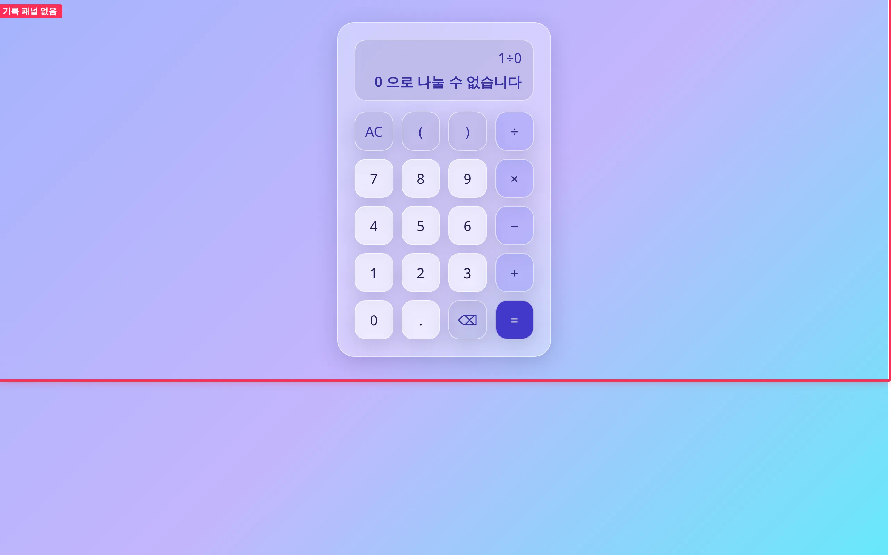
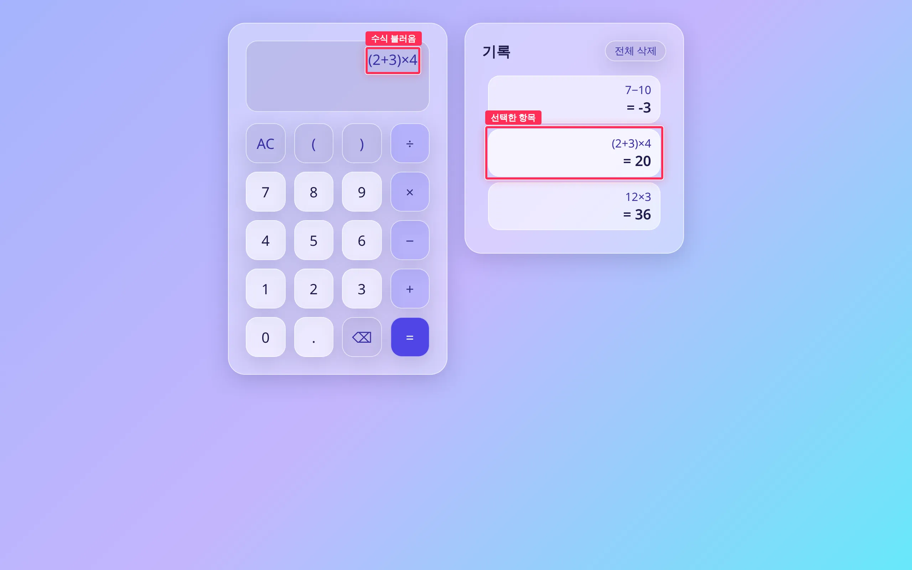
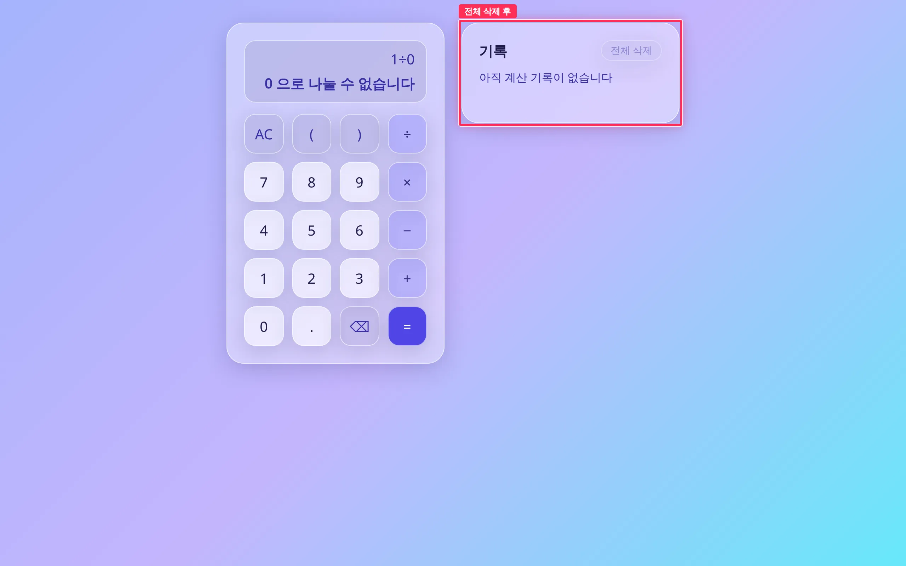
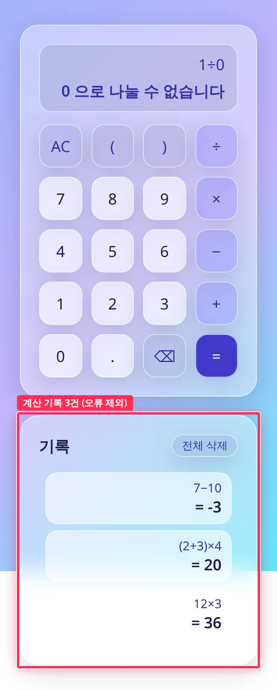
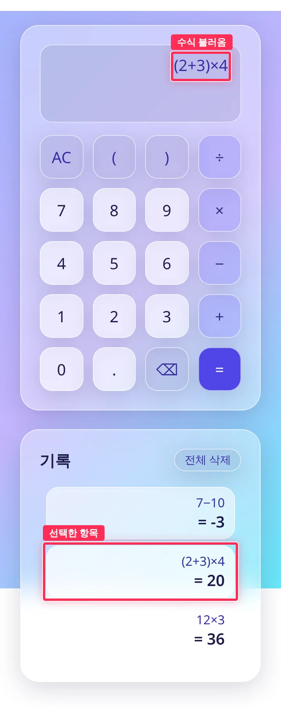
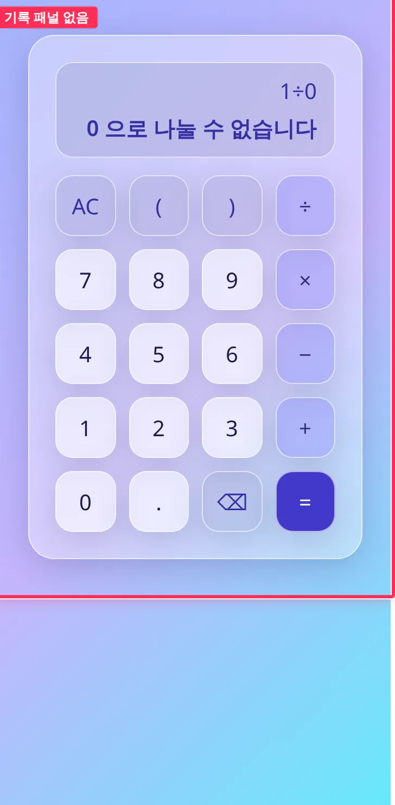
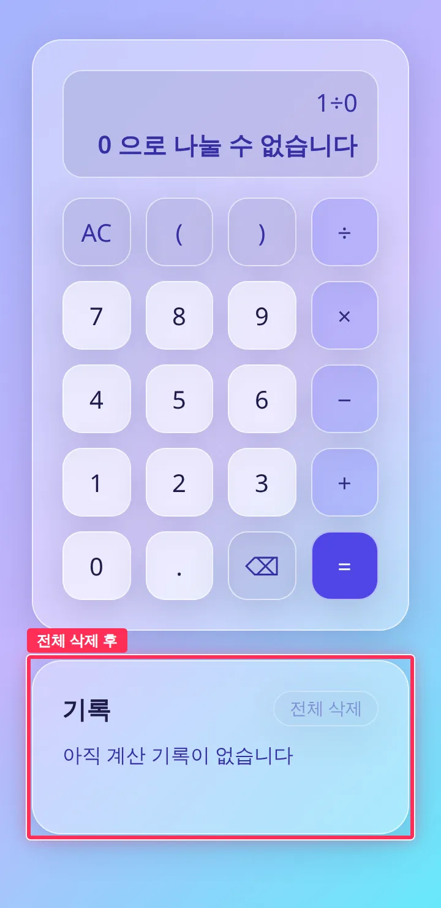

## 작업 요약

계산기 옆에 `.glass` 기록 패널을 붙였습니다. = 로 계산에 성공할 때마다 (수식, 결과)를 맨 위에 추가하고, 50건을 넘으면 가장 오래된 항목부터 뺍니다.
항목은 D2 `btn--number` 버튼이라 클릭이나 키보드(Tab → Enter/Space)로 고르면 수식이 입력 줄로 들어오고, 이어서 = 를 누르면 다시 계산됩니다. 전체 삭제 버튼은 목록을 비우며, 기록이 없을 때는 꺼집니다.
**오류 결과는 기록하지 않습니다.** 다시 쓸 값이 없고 목록만 어지럽히기 때문입니다. 기록 상태는 순수 함수(`src/ui/history.ts`)로 관리하고, 엔진과 디자인 토큰은 수정하지 않았습니다.

## 변경 전후 — 1280px

| 상태 | 전 | 후 |
| --- | --- | --- |
| 기록 여러 건 |  |  |
| 항목 재사용 직후 |  |  |
| 전체 삭제 후 |  |  |

조작 순서는 계산마다 AC 를 누른 뒤 `12×3 =`, `(2+3)×4 =`, `7−10 =`, `1÷0 =`(오류)입니다. 재사용은 여기에 2번째 항목 클릭을, 전체 삭제는 전체 삭제 클릭을 더한 상태입니다.
빨간 박스가 변경 구간입니다. 전 화면에는 패널이 없어 `#app` 전체에 "기록 패널 없음" 박스를 그렸습니다. 후 화면의 박스는 `.history` 패널(오류를 뺀 3건과 전체 삭제 후 빈 안내)과, 재사용 상태의 선택 항목 및 입력 줄에 불러온 수식입니다.

360px 전후 (패널이 계산기 아래로 내려감)

| 상태 | 전 | 후 |
| --- | --- | --- |
| 기록 여러 건 |  |  |
| 항목 재사용 직후 |  |  |
| 전체 삭제 후 |  |  |

360px 전체 페이지 캡처의 위아래 흰 띠는 기존 `body` 배경(`background-attachment: fixed` + `min-height: 100vh`)이 뷰포트보다 긴 전체 페이지 스크린샷에서 생기는 현상입니다. 전 화면에도 똑같이 나타나며, 실제 스크롤 화면에서는 배경이 고정되어 보이지 않습니다.

## 변경 파일

- `src/ui/history.ts` (신규): `HistoryEntry`, `HISTORY_LIMIT = 50`, `addEntry`(맨 위에 추가하고 상한을 넘는 부분 잘라냄), `record`(value 결과만 기록), `clearHistory`
- `src/ui/history.test.ts` (신규): 추가 순서, 상한(일반·기본 50건), 불변성, 오류·미계산 미기록, 전체 삭제를 다루는 단위 테스트 8건
- `src/ui/calculator.ts`: 기록 패널 마운트, = 성공 시 `record`, 항목 클릭으로 수식 불러오기, 전체 삭제, 빈 안내와 삭제 버튼 disabled 처리. 렌더는 `textContent` 로 함
- `src/ui/calculator.css`: `.app-layout` flex-wrap(1280px 에서는 나란히, 360px 에서는 아래로), 기록 목록 스타일(기존 토큰만 사용, 7버튼 높이를 넘으면 스크롤)

## 검증

- `npm test`(146 passed, history 8건 포함), `npm run typecheck`, `npm run build` 로컬 통과. 출력은 [after/verify.txt](https://github.com/Mineru98/toy-calculate/blob/main/.issue/11/evidence/after/verify.txt)에 있고, 변경 전 기준선은 [before/verify.txt](https://github.com/Mineru98/toy-calculate/blob/main/.issue/11/evidence/before/verify.txt)입니다.
- Playwright 클릭 시나리오(1280x800, 360x740, 결과는 verify.txt): 오류를 뺀 3건 기록, 항목 클릭 후 수식 복원과 = 재계산(20), Tab+Enter 키보드 선택, 전체 삭제 후 0건과 빈 안내, 51회 계산 후 50건(맨 아래가 `2`), 가로 넘침 없음

## 남은 이슈

- 기록은 세션 메모리에만 있어 새로고침하면 사라집니다. 보존은 후행 이슈 #12(H2) 범위입니다.
- 같은 수식을 연속으로 계산해도 매번 새 항목으로 쌓습니다. 이슈의 "계산할 때마다 추가" 요구를 그대로 따른 결과입니다.
