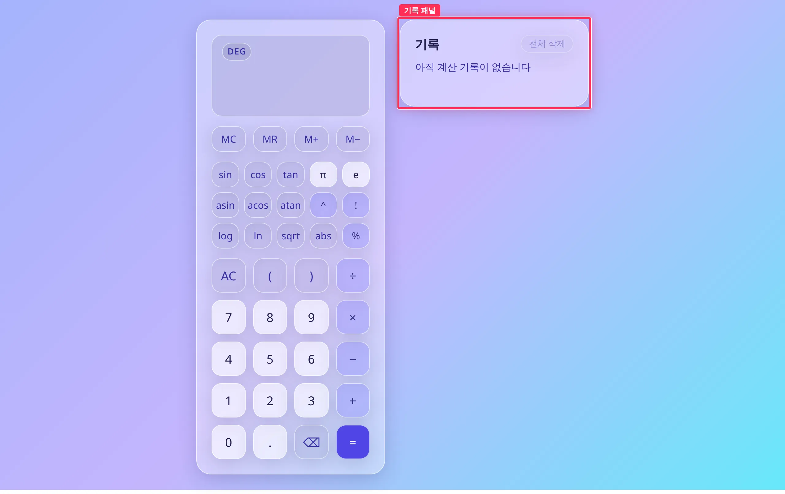
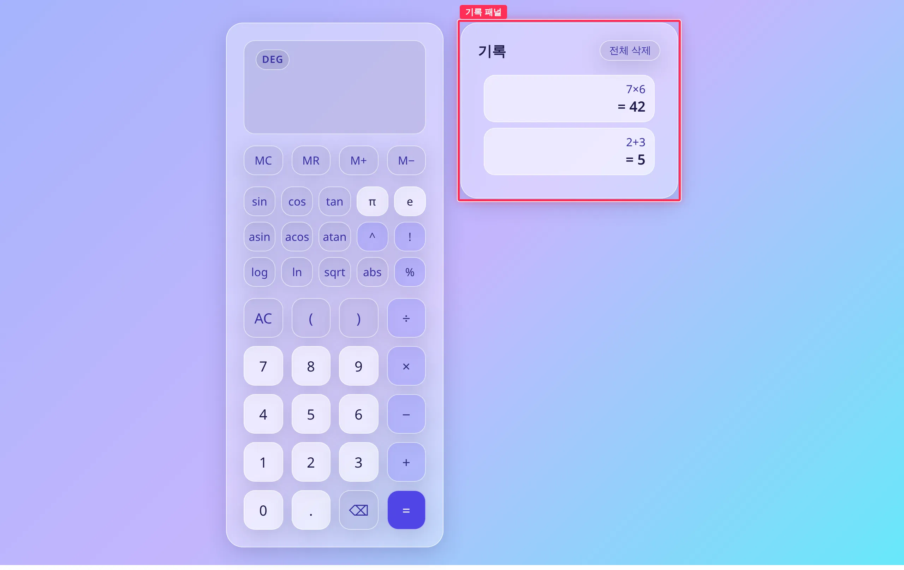
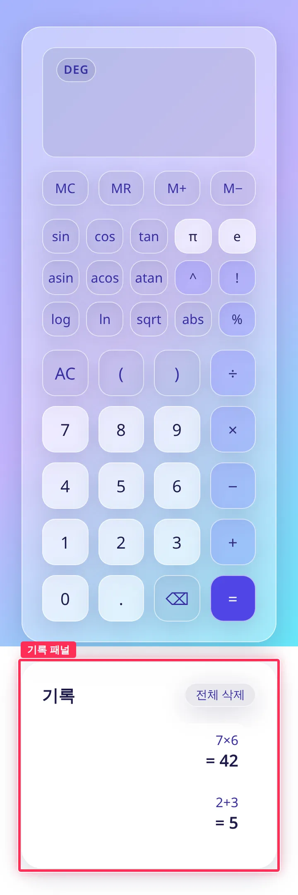
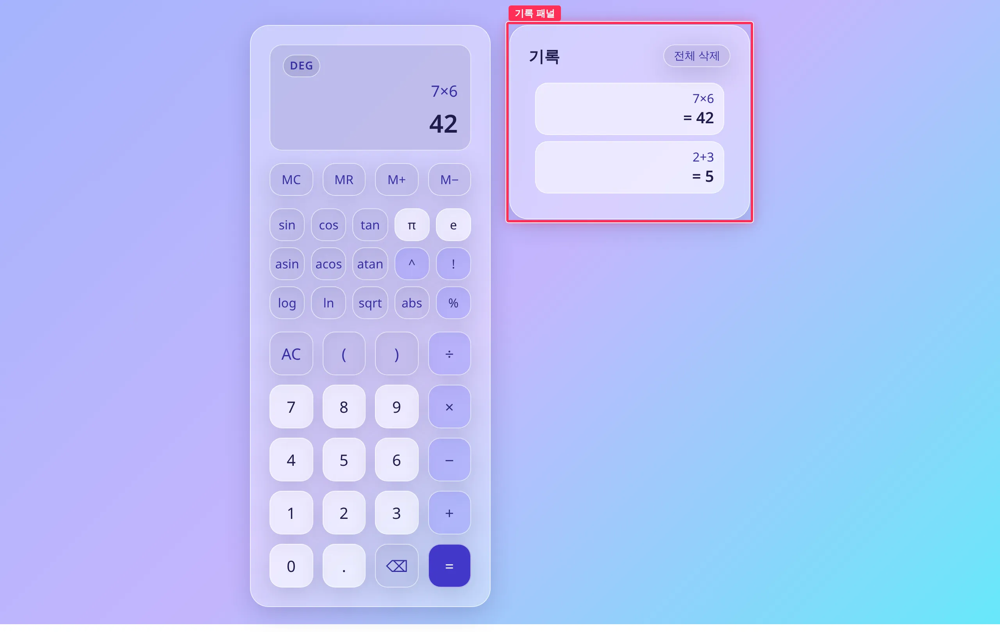
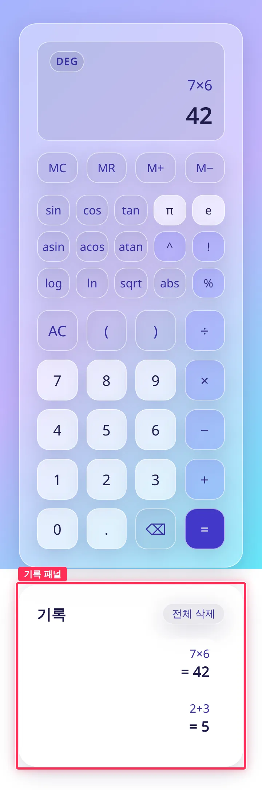
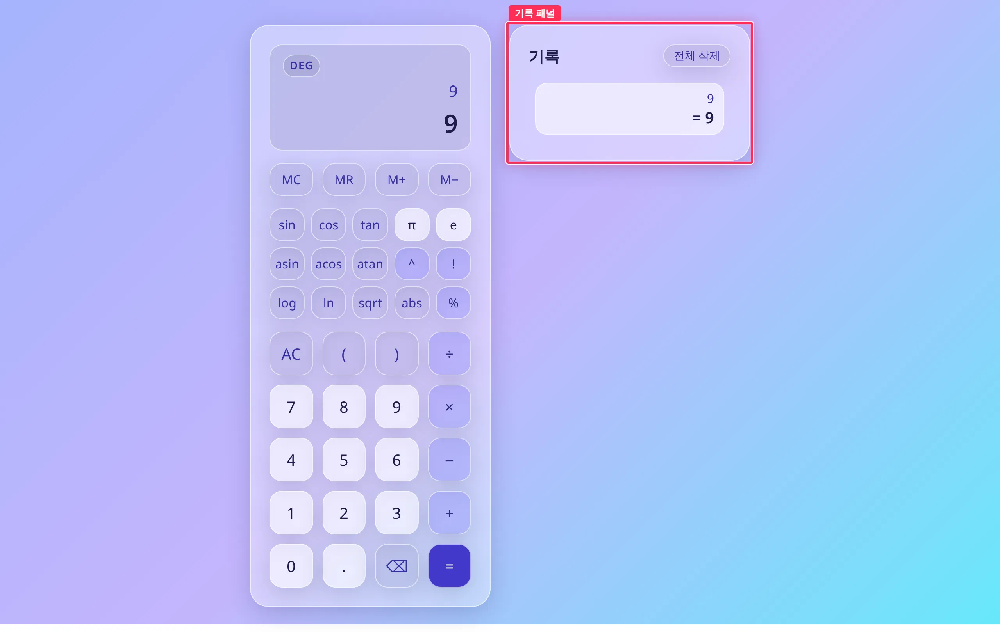
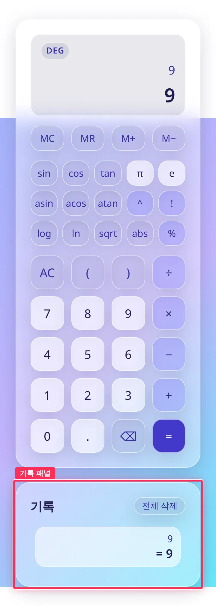

## 작업 요약

계산 기록을 `toy-calculate:history:v1` 키로 localStorage 에 저장하고, 시작할 때 복원합니다. 키 이름은 메모리 키(`toy-calculate:memory:v1`)와 같은 형식을 따랐습니다.
저장값이 손상됐거나 형식이 맞지 않을 때, 또는 localStorage 에 접근하면 예외가 나는 환경에서는 예외 없이 빈 기록으로 시작합니다. 전체 삭제를 누르면 저장 키도 지웁니다.
저장소 도우미(`browserStorage`, `MemoryStorage`)는 #13 에서 만든 `src/ui/memory.ts` 것을 그대로 가져다 썼습니다.

## 변경 전후 — 2건 계산 후 새로고침

| 전 | 후 |
| --- | --- |
|  |  |
|  |  |

빨간 박스가 변경 구간(기록 패널)입니다. 두 화면 모두 `2+3=` → AC → `7×6=` 을 누른 뒤 새로고침했습니다. 전에는 목록이 비고, 후에는 순서와 내용이 그대로 남습니다.

새로고침 전 · 전체 삭제 후 · 손상값 (전후 12장)

| 장면 | 전 | 후 |
| --- | --- | --- |
| 새로고침 전 1280px |  |  |
| 새로고침 전 360px |  |  |
| 전체 삭제 → 새로고침 1280px |  |  |
| 전체 삭제 → 새로고침 360px |  |  |
| 저장값 `{broken` → 새로고침 → `9=` 1280px |  |  |
| 저장값 `{broken` → 새로고침 → `9=` 360px |  |  |

## 브라우저 확인 (Playwright, 360x780 · 1280x800)

DevTools Application 탭 캡처 대신 저장값 원문을 기록했습니다. 원본: `.issue/12/evidence/{before,after}/verify.txt`

| 확인 항목 | 전 | 후 |
| --- | --- | --- |
| 새로고침 전 저장값 | `null` | `[{"expression":"7*6","result":"42"},{"expression":"2+3","result":"5"}]` |
| 새로고침 후 목록 | `[]` | `7×6 = 42`, `2+3 = 5` (순서 유지) |
| 전체 삭제 직후 저장값 → 새로고침 후 목록 | `null` → `[]` | `null` → `[]` |
| 저장값 `{broken` → 새로고침 | 빈 목록, 페이지 오류 0건 | 빈 목록, 페이지 오류 0건 |
| localStorage 접근 예외 환경에서 `4+4=` | 목록에 표시, 페이지 오류 0건 | 목록에 표시, 페이지 오류 0건 |

## 변경 파일

- `src/ui/history.ts`: `HISTORY_STORAGE_KEY`, `loadHistory`, `saveHistory` 추가. 저장값이 배열이 아니거나 항목 하나라도 `{expression: string, result: string}` 형식이 아니면 빈 기록으로 읽습니다. 상한(50건)을 넘는 저장값은 앞에서부터 50건만 읽습니다.
- `src/ui/calculator.ts`: 시작할 때 기록을 복원하고, `=` 로 기록이 바뀌었을 때와 전체 삭제할 때 저장합니다.
- `src/ui/history.test.ts`: 저장·복원 왕복, 빈 기록이면 키 삭제, 손상값 12종, 상한 자르기, 추가 필드 버림, 저장소 예외, 저장소 없음 등 20건을 추가했습니다(파일 전체 28건).

## 검증

| 항목 | 결과 | 원본 |
| --- | --- | --- |
| `npm test` | 225 passed (exit 0) | `.issue/12/evidence/after/npm-test.txt` |
| `npm run typecheck` | exit 0 | `.issue/12/evidence/after/npm-typecheck.txt` |
| `npm run build` | exit 0 | `.issue/12/evidence/after/npm-build.txt` |

## 남은 이슈

- 없음. 참고로, 결과가 표시된 뒤 숫자를 누르면 새 수식을 시작하지 않고 기존 수식에 이어 붙는 입력 규칙은 이번 범위가 아니라서 손대지 않았습니다. 증거 시나리오에서는 계산 사이에 AC 를 눌렀습니다.
