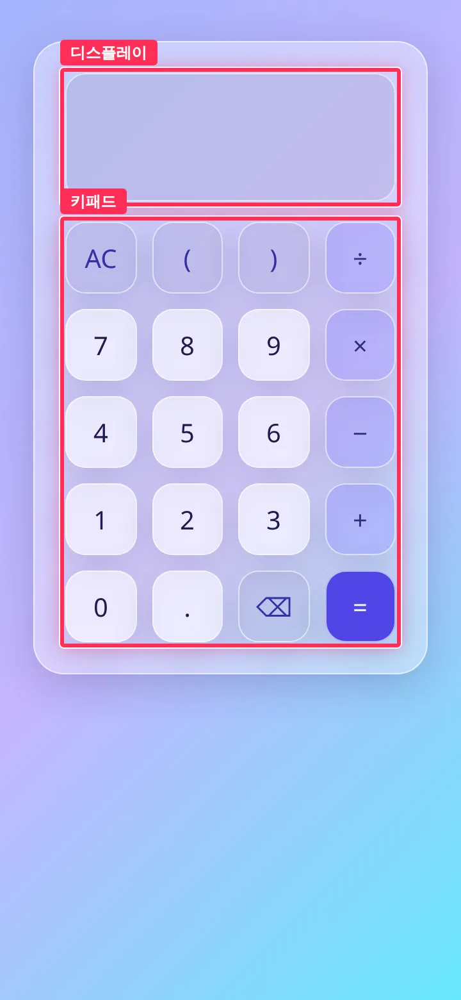
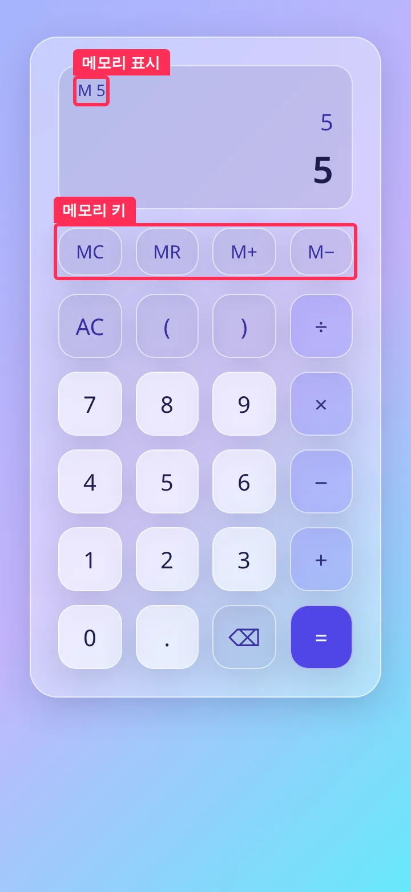
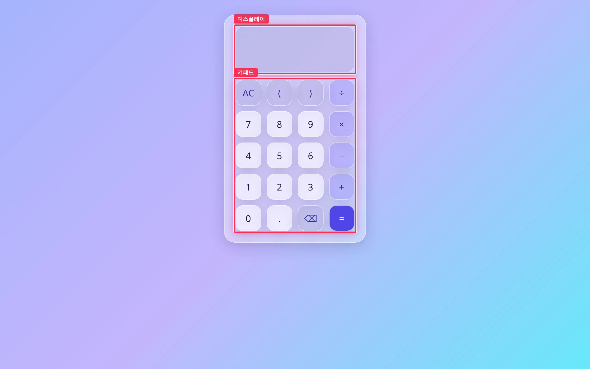
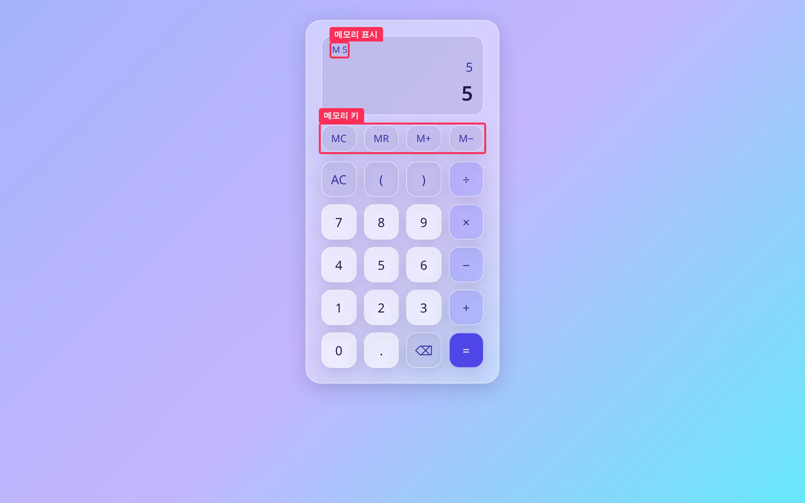
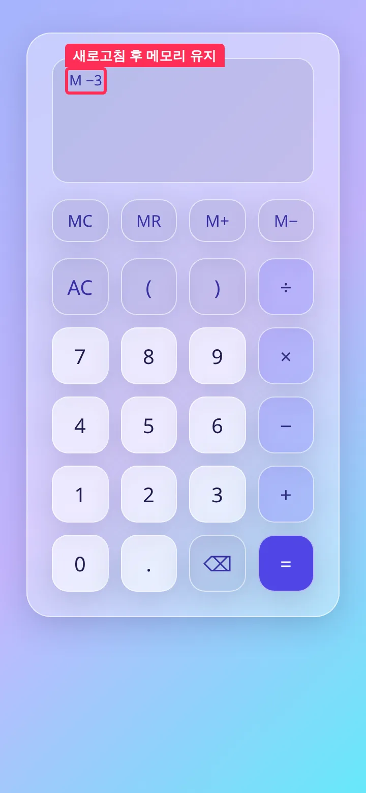
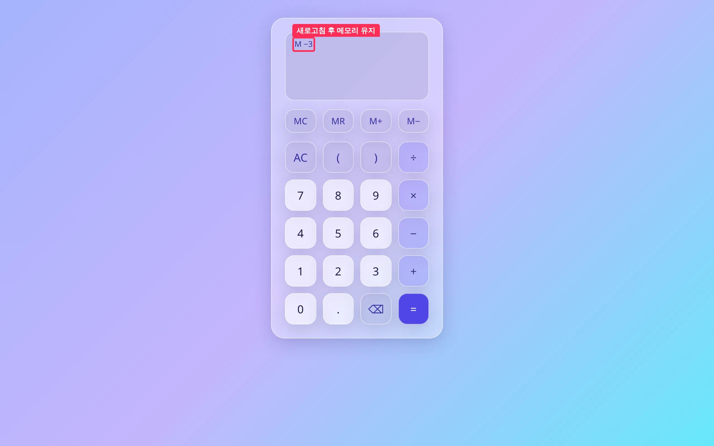
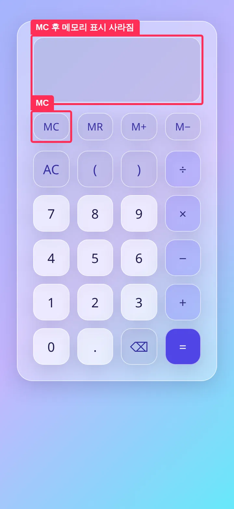
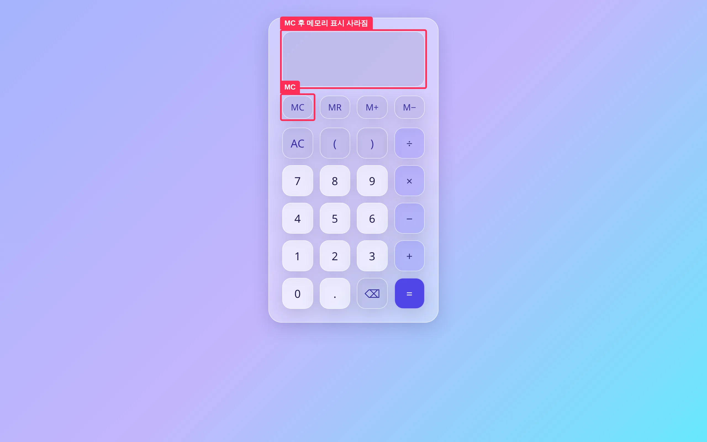

## 작업 요약

기본 화면에 메모리 키 MC·MR·M+·M- 를 추가하고 메모리 값을 디스플레이 왼쪽 위에 `M <값>` 으로 표시합니다.
값은 `toy-calculate:memory:v1` 키로 localStorage 에 보존하고, 저장값이 손상됐거나 저장소에 접근할 수 없으면 예외 없이 빈 메모리로 시작합니다.
메모리 로직은 순수 모듈 `src/ui/memory.ts` 로 분리해 기존 키패드(20키)와 `press` 계약을 바꾸지 않았습니다.

## 변경 전후

| 전 | 후 |
| --- | --- |
|  |  |
|  |  |

빨간 박스가 변경 구간입니다. 전 화면에는 디스플레이와 키패드를, 후 화면에는 새로 생긴 메모리 표시와 메모리 키 줄을 표시했습니다.

새로고침 후 유지 · MC 후 (4장)

| 360px | 1280px |
| --- | --- |
|  |  |
|  |  |

## 동작 규칙

- M+ / M-: 현재 수식의 계산값을 메모리에 더하고 뺍니다. 수식이 오류이거나 비어 있으면, 또는 합이 유한수를 벗어나면 메모리를 바꾸지 않습니다.
- MR: 결과가 표시된 상태면 메모리 값으로 새 수식을 시작합니다. 수식 끝이 숫자면 그 숫자를 메모리 값으로 바꾸고, 연산자나 `(` 뒤면 이어 붙입니다. `)`·`!`·`%` 뒤에서는 아무것도 하지 않습니다. 음수는 `(-3)` 처럼 괄호로 감싸 넣고, `1e21` 같은 지수 표기는 엔진이 읽을 수 있게 자릿수 그대로 풀어 넣습니다.
- MC: 메모리 표시를 지우고 저장 키를 삭제합니다.
- AC 는 메모리를 지우지 않습니다.

## 변경 파일

- `src/ui/memory.ts` (신규): 메모리 키 정의, `pressMemory`, `toOperand`, `loadMemory`/`saveMemory`/`browserStorage`
- `src/ui/memory.test.ts` (신규): 연산, 오류일 때 메모리 불변, MR 삽입 규칙, 지수값 왕복, 손상값, 저장소 예외 등 36건
- `src/ui/calculator.ts`: 메모리 표시 줄과 메모리 키 줄 추가, 시작 시 불러오기, 값이 바뀔 때 저장
- `src/ui/calculator.css`: 메모리 표시와 메모리 키 줄 스타일

## 검증

| 항목 | 결과 | 원본 |
| --- | --- | --- |
| `npm test` | 174 passed (exit 0) | `.issue/13/evidence/after/npm-test.txt` |
| `npm run typecheck` | exit 0 | `.issue/13/evidence/after/npm-typecheck.txt` |
| `npm run build` | exit 0 | `.issue/13/evidence/after/npm-build.txt` |

Playwright 로 360x780 · 1280x800 에서 실제 키를 눌러 아래 흐름을 확인했고, 페이지 오류는 0건이었습니다.

- `5 = M+` 를 누르면 `M 5` 가 표시되고 저장값도 `5` 가 됩니다.
- `1 ÷ 0 =` 오류 상태에서 M+ 와 M- 를 눌러도 `M 5` 가 그대로입니다.
- `8 = M-` 를 누르면 `M −3` 이 되고, `2 × MR =` 은 `2×(−3)` → `-6` 입니다.
- 새로고침 뒤에도 `M −3` 이 유지됩니다.
- MC 를 누르면 표시와 저장 키가 사라지고, 새로고침 뒤에도 비어 있습니다.
- 저장값이 `{broken` 으로 손상돼 있으면 빈 메모리로 시작합니다.
- `localStorage` 에 접근하면 예외가 나는 환경에서도 `7 = M+` 를 누르면 `M 7` 이 표시됩니다(저장 없이 메모리 안에서만 동작).

## 남은 이슈

- 없음. MR 의 삽입 규칙(결과가 표시된 뒤에는 새 수식, 끝 숫자는 교체)은 리뷰에서 지적받아 반영한 해석입니다. 다른 규칙을 원하시면 말씀해 주세요.
