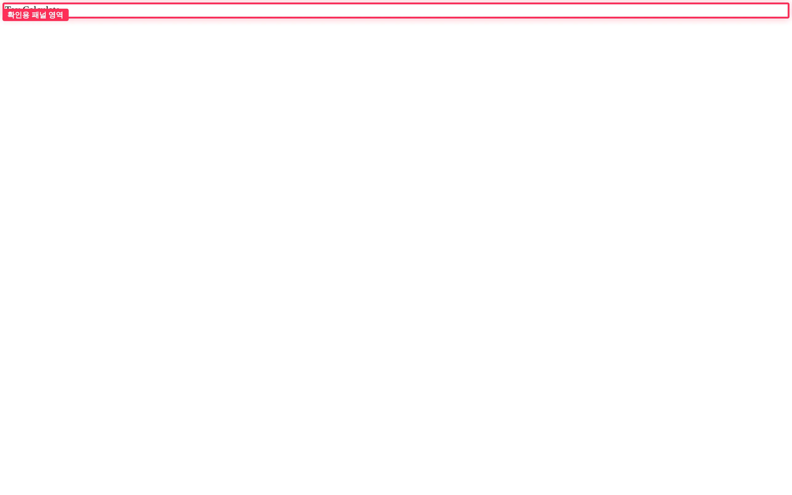
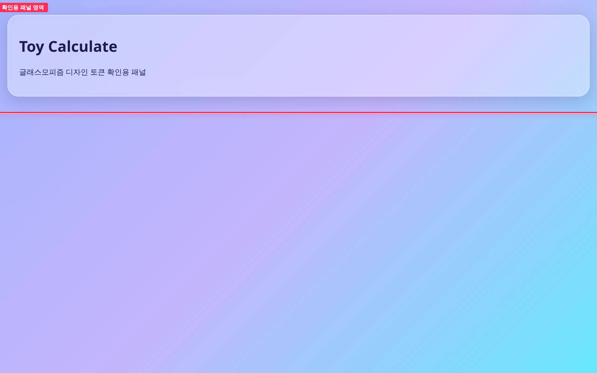
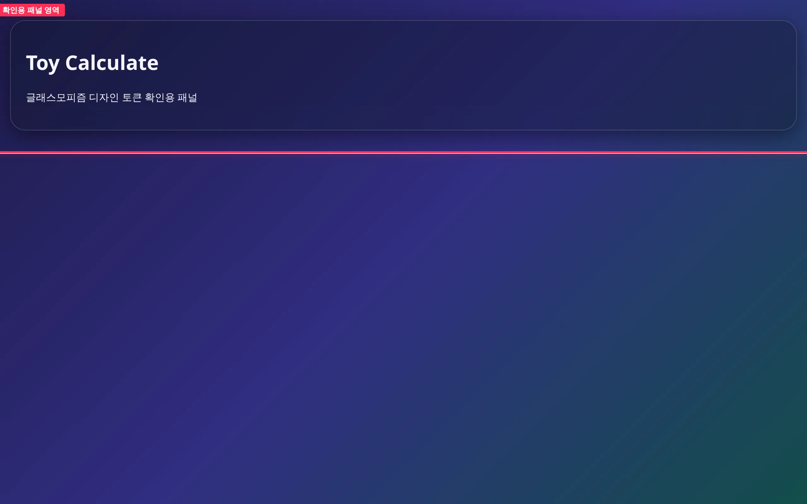
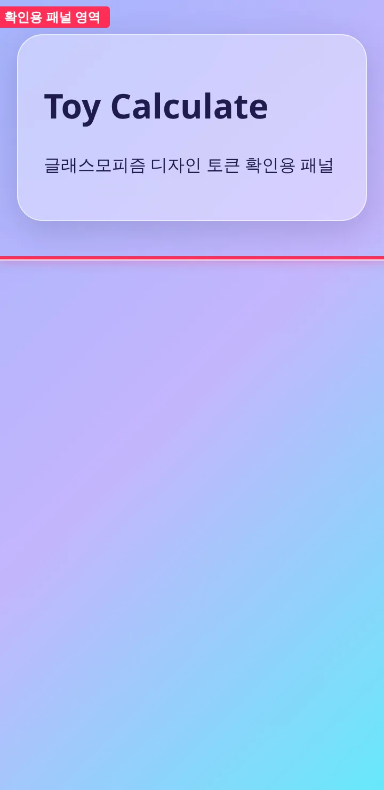
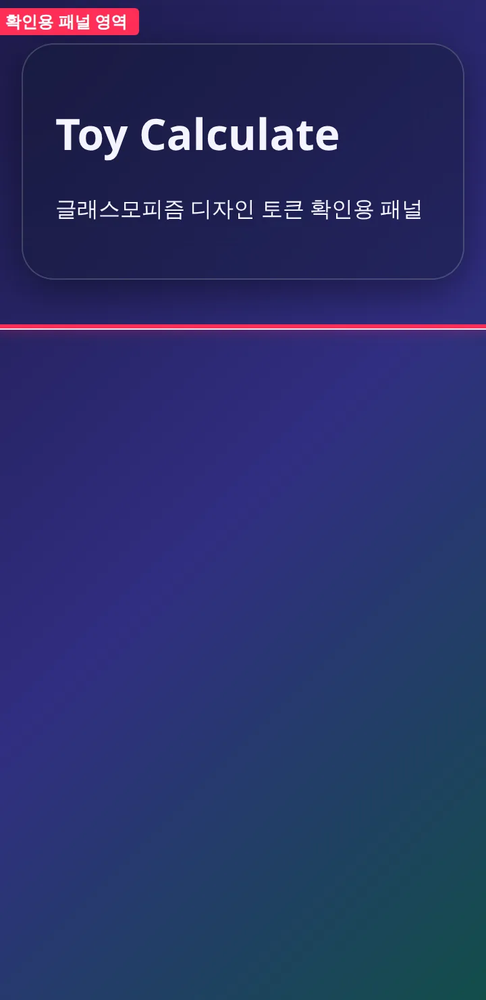

## 작업 요약

`src/styles/` 에 글래스모피즘 디자인 토큰 6종(색·blur·테두리·그림자·반경·간격), 그라디언트 페이지 배경, `.glass` 패널을 추가하고 `src/main.ts` 에서 로드했습니다.
라이트/다크는 `prefers-color-scheme` 미디어 쿼리에서 색·그림자 토큰 값만 바꿔 대응합니다. `.glass` 는 하드코딩 값 없이 토큰만 씁니다.
확인용으로 루트에 `.glass` 패널 하나를 올렸습니다.

## 변경 전후 (1280px)

| 모드 | 전 | 후 |
| --- | --- | --- |
| 라이트 |  |  |
| 다크 |  |  |

360px 전후

| 모드 | 전 | 후 |
| --- | --- | --- |
| 라이트 |  |  |
| 다크 |  |  |

빨간 박스(`#app`)가 변경 구간입니다. 전에는 스타일 없이 텍스트만 있었고, 후에는 그라디언트 배경 위에 반투명 유리 패널이 올라갑니다. 다크에서도 패널 위 텍스트 대비가 유지됩니다.

## 변경 파일

- `src/styles/tokens.css` — 토큰 정의, `prefers-color-scheme: dark` 에서 값만 재정의
- `src/styles/base.css` — box-sizing, 그라디언트 body 배경, `#app` 여백
- `src/styles/glass.css` — `.glass` 패널 (토큰만 사용)
- `src/styles/index.css` — 위 세 파일 `@import`
- `src/main.ts` — 스타일 로드, 확인용 `.glass` 패널 렌더

## 검증

- `npm test` (테스트 파일 없음, exit 0) / `npm run typecheck` / `npm run build` 로컬 통과 — 출력: [verify.txt](https://github.com/Mineru98/toy-calculate/blob/main/.issue/4/evidence/after/verify.txt)
- 뷰포트 360x740 · 1280x800, 라이트·다크 각각 캡처 (Playwright `colorScheme`)
- `.glass` 블록에 하드코딩 색·px 없음 확인

## 남은 이슈

- 없음. 색 팔레트는 이슈에 지정이 없어 보라~남색~청록 계열로 정했습니다. 후속(#5, #6)에서 토큰 값만 조정하면 됩니다.
