## 작업 요약

`src/styles/button.css` 에 `.btn` 기본과 변형 4종(`--number` · `--operator` · `--function` · `--accent`), hover / active / disabled, `:focus-visible` 포커스 링을 추가했습니다.
색·크기·링은 모두 `tokens.css` 의 새 토큰으로 정의했고, 다크 모드는 #4 와 같이 `prefers-color-scheme` 에서 색 토큰 값만 바꿉니다.
포커스 링은 실선 outline 에 반대 색 헤일로(box-shadow)를 겹쳐 유리 배경 위에서도 보이게 했고, 마우스 클릭만으로는 링이 남지 않습니다.

## 변경 전후 — 버튼 표 (1280px)

| 모드 | 전 | 후 |
| --- | --- | --- |
| 라이트 | 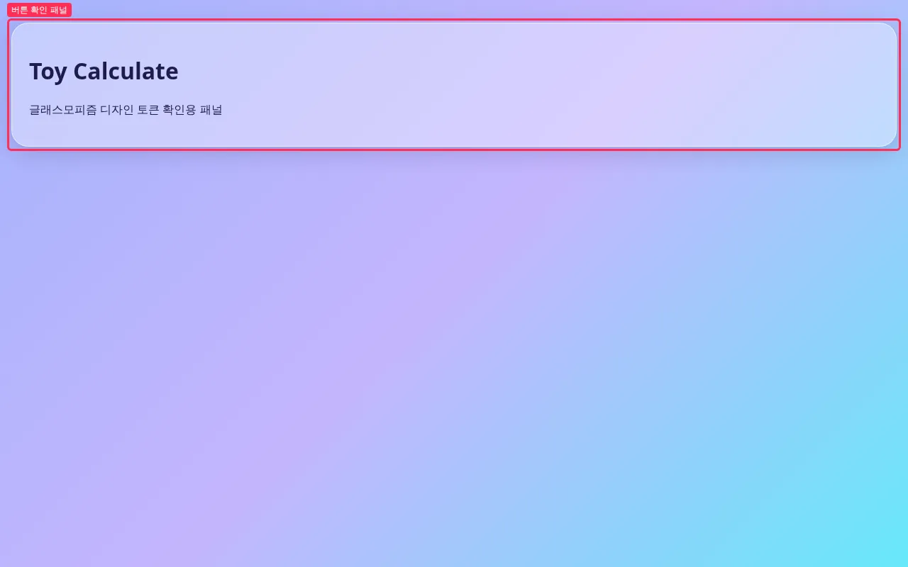 | 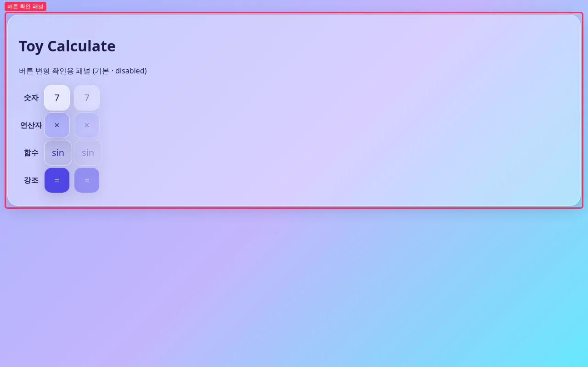 |
| 다크 | 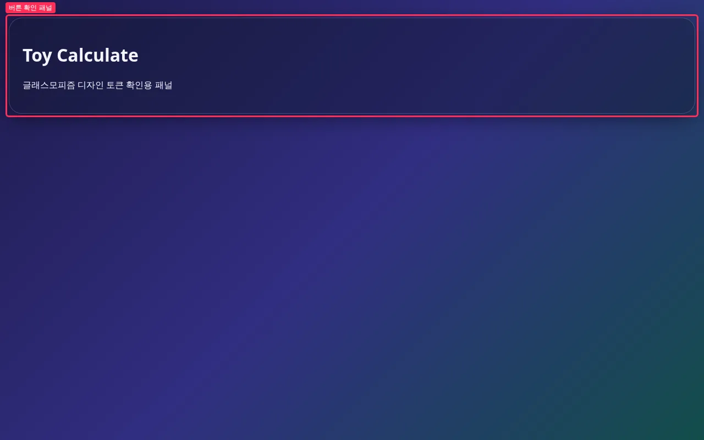 | 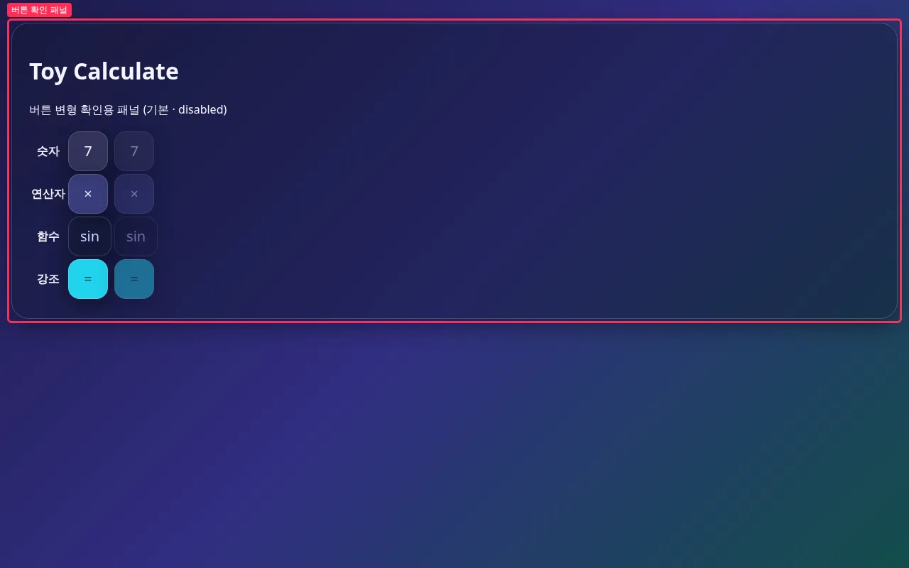 |

빨간 박스(`#app .glass`)가 변경 구간입니다. 각 행은 변형 하나이고, 왼쪽이 기본, 오른쪽이 disabled 입니다.

## 포커스 링 (1280px)

| 상태 | 전 | 후 |
| --- | --- | --- |
| 라이트 · Tab 2회 | 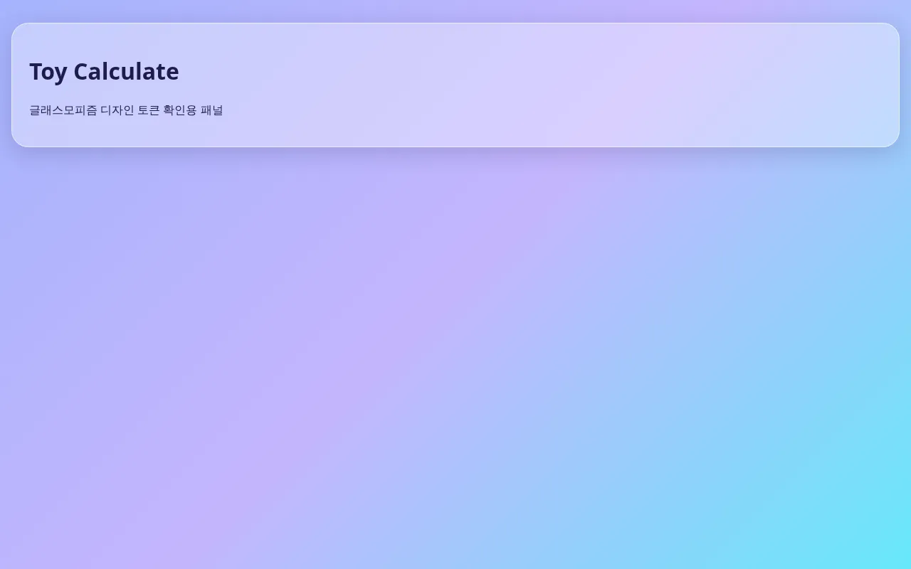 | 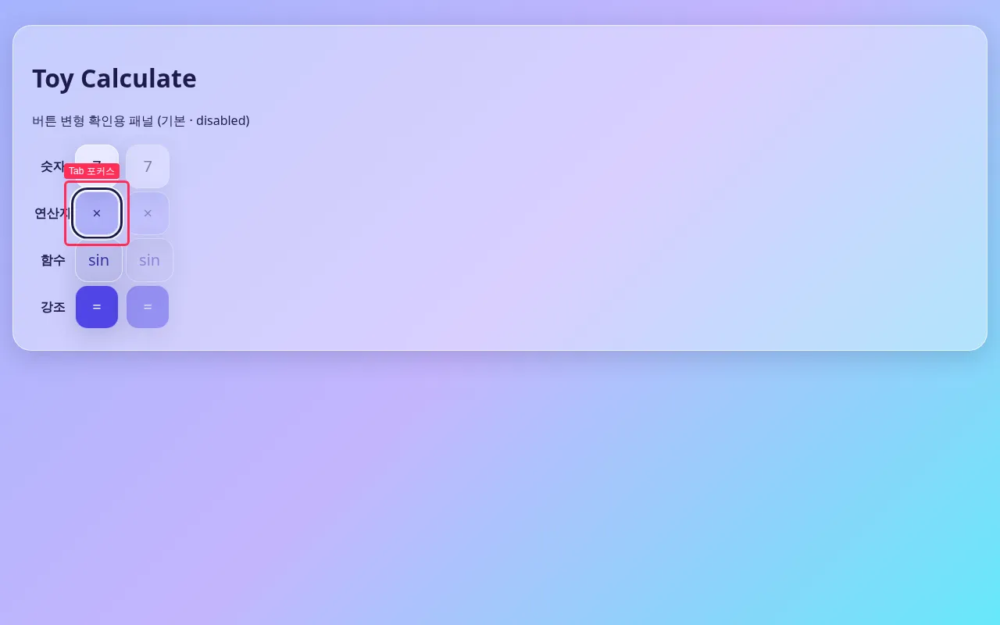 |
| 다크 · Tab 2회 | 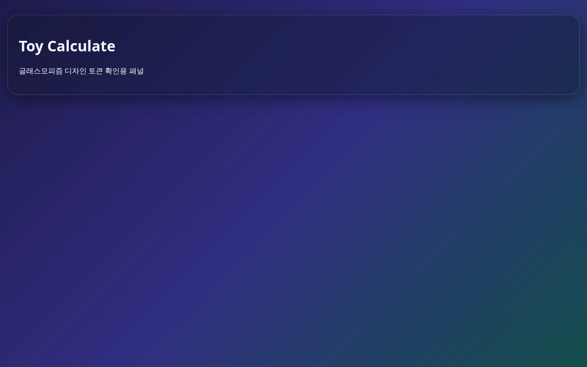 | 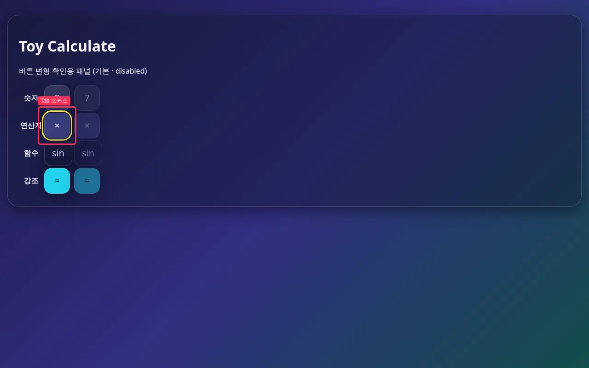 |
| 라이트 · 마우스 클릭 |  | 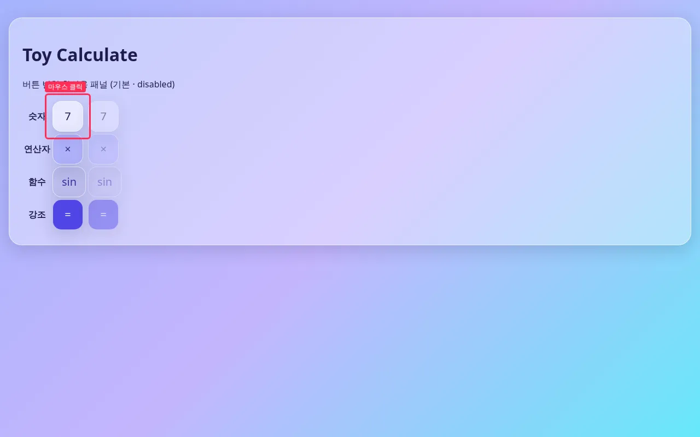 |

전에는 버튼이 없어 Tab·클릭 대상이 없었으므로 박스를 그리지 못했습니다. 후에는 Tab 으로 두 번째 활성 버튼(연산자 ×)에 링이 보이고(라이트 남색 / 다크 노랑), 마우스로 누른 숫자 7 에는 링이 없습니다(`outline-style: none`).

360px 전후

| 모드 | 전 | 후 |
| --- | --- | --- |
| 라이트 | 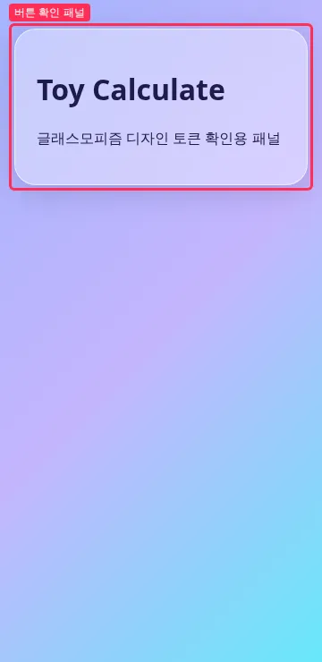 | 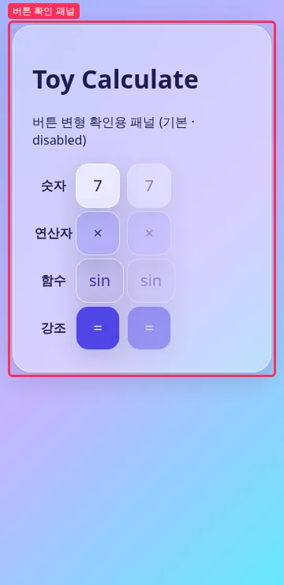 |
| 다크 | 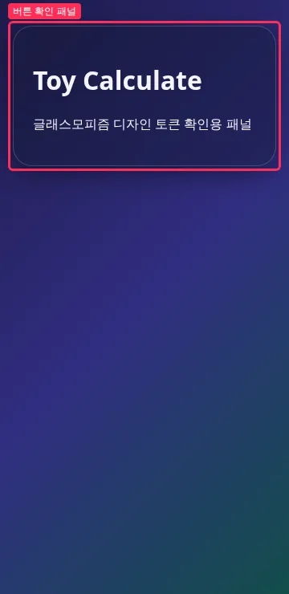 | 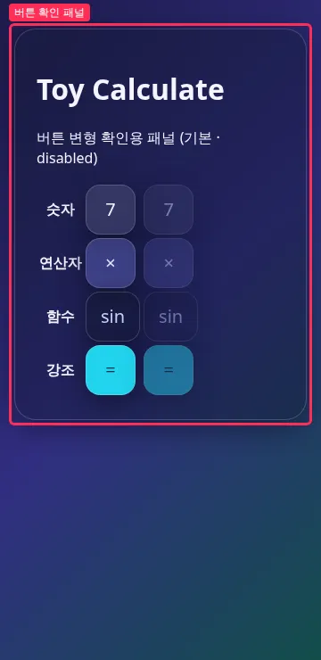 |

## 변경 파일

- `src/styles/tokens.css` — 버튼 변형 색(배경·hover·글자), 포커스 링·헤일로, disabled 불투명도, pressed 스케일, 버튼 크기 토큰. 다크 블록에서 색만 재정의
- `src/styles/button.css` (신규) — `.btn`, 변형 4종, hover/active/disabled, `:focus-visible` (하드코딩 색·px 없음)
- `src/styles/index.css` — `button.css` import
- `src/main.ts` — 확인용 패널을 변형 4종 × 기본·disabled 버튼 표로 교체 (#7 에서 실제 화면으로 대체 예정)

## 검증

- `npm test` (41 passed) / `npm run typecheck` / `npm run build` 로컬 통과 — 출력: [verify.txt](https://github.com/Mineru98/toy-calculate/blob/main/.issue/5/evidence/after/verify.txt)
- `button.css` 에 hex·rgb·px 리터럴 없음 (grep 결과 verify.txt 포함)
- Playwright computed style: Tab 포커스 `outline: solid 3px` (라이트 rgb(30,27,75) / 다크 rgb(253,224,71)), 마우스 클릭 후 `outline-style: none`, 변형 4종 배경색이 라이트·다크 각각 서로 다름, hover 배경 변경·active `scale(0.96)`·disabled `opacity 0.45` 확인 (verify.txt)
- 뷰포트 360x740 · 1280x800, 라이트·다크 (Playwright `colorScheme`)

## 남은 이슈

- 전환 애니메이션은 넣지 않았습니다. reduced-motion·backdrop-filter 대체 배경은 D3 범위입니다.
