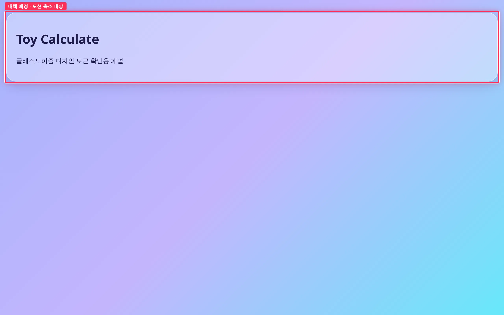
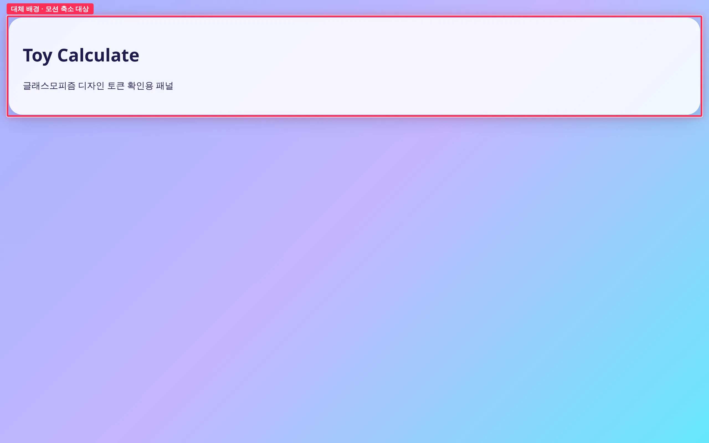
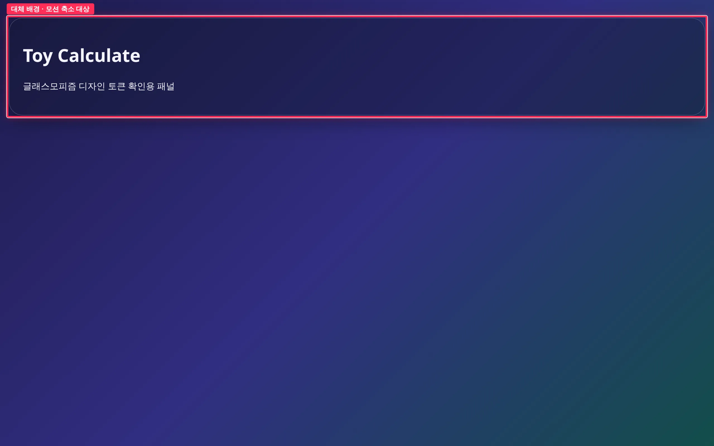
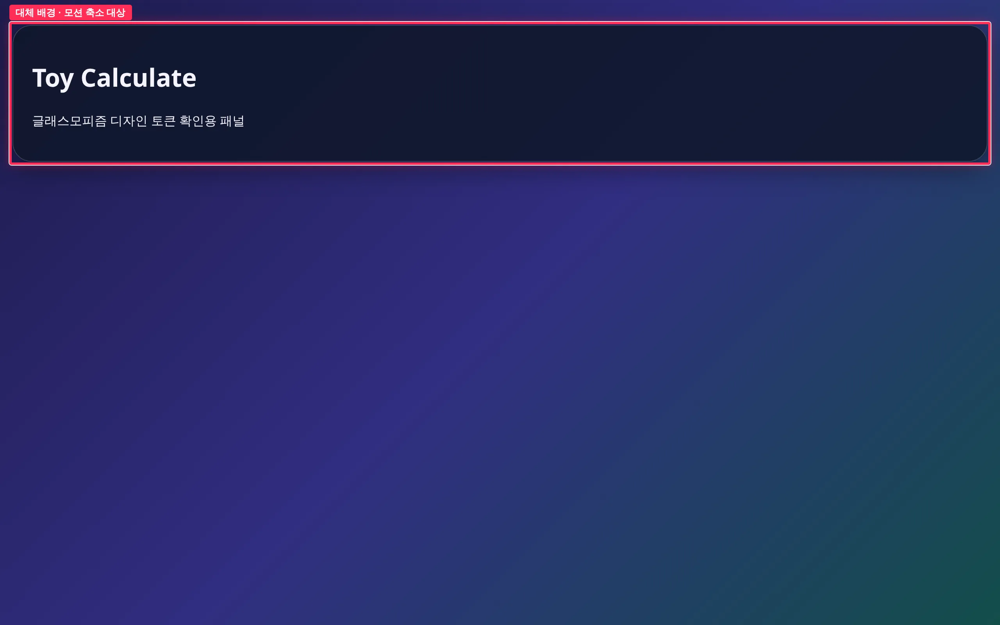

## 작업 요약

`backdrop-filter` 미지원 환경용 대체 배경 토큰 `--color-glass-fallback`(라이트 0.85 / 다크 0.88 알파)을 추가하고, `@supports not` 조건에서 `.glass` 가 이 토큰을 쓰게 했습니다.
`prefers-reduced-motion: reduce` 에서는 모든 요소의 transition·animation 지속시간을 0.01ms, 반복 1회로 줄입니다. 현재 화면에는 전환이 없어 후속 버튼(#5) 등에 미리 적용되는 전역 규칙입니다.

## 변경 전후 — backdrop-filter 미지원 시뮬레이션 (1280px)

| 모드 | 전 | 후 |
| --- | --- | --- |
| 라이트 |  |  |
| 다크 |  |  |

빨간 박스(`.glass`)가 변경 구간입니다. 전에는 blur 없이 반투명(0.35 / 0.4) 배경만 남아 그라디언트가 비쳤고, 후에는 대체 토큰이 적용돼 패널 위 텍스트 대비가 확보됩니다.

Chromium 은 backdrop-filter 를 지원해 `@supports not` 이 실제로 참이 되지 않으므로, 캡처 스크립트가 미지원 환경을 시뮬레이션했습니다. `.glass` 의 backdrop-filter 를 `none` 으로 끄고, 스타일시트에서 backdrop-filter 를 부정하는 `@supports` 규칙 본문을 찾아 그대로 적용했습니다(전: 찾은 규칙 0개 → `rgba(255,255,255,0.35)`, 후: `.glass { background: var(--color-glass-fallback) }` → `rgba(255,255,255,0.85)`).

## 변경 전후 — reduced-motion 에뮬레이션

| 전 | 후 |
| --- | --- |
|  |  |

화면은 정적이라 스크린샷은 같습니다. 효과는 Playwright `reducedMotion: 'reduce'` 에서 transition 0.3s · animation 1s infinite 를 준 probe 요소의 계산값으로 확인했습니다.

| 속성 | 전 | 후 |
| --- | ---: | ---: |
| transition-duration | 0.3s | **0.01ms** |
| animation-duration | 1s | **0.01ms** |
| animation-iteration-count | infinite | **1** |

원본: [before/motion-probe.json](https://github.com/Mineru98/toy-calculate/blob/main/.issue/6/evidence/before/motion-probe.json) · [after/motion-probe.json](https://github.com/Mineru98/toy-calculate/blob/main/.issue/6/evidence/after/motion-probe.json)

## 변경 파일

- `src/styles/tokens.css` — `--color-glass-fallback` 토큰 (라이트·다크)
- `src/styles/glass.css` — `@supports not ((backdrop-filter: blur(1px)) or (-webkit-backdrop-filter: blur(1px)))` 에서 대체 배경
- `src/styles/base.css` — `@media (prefers-reduced-motion: reduce)` 전역 규칙

## 검증

- `npm test` (41 passed) / `npm run typecheck` / `npm run build` 로컬 통과 — 출력: [verify.txt](https://github.com/Mineru98/toy-calculate/blob/main/.issue/6/evidence/after/verify.txt)
- 빌드 산출 CSS 에 `@supports not`·`prefers-reduced-motion` 블록이 남아 있음을 확인

## 남은 이슈

- 실제 미지원 브라우저에서의 확인은 하지 않았습니다(시뮬레이션으로 대체).
