## 작업 요약

#5 의 버튼 확인용 표를 실제 계산기 화면으로 바꿨습니다. `.glass` 패널 안에 수식 줄 + 결과 줄 디스플레이와 4열 키패드(0~9 · . · + − × ÷ · ( ) · AC · ⌫ · =)를 넣었습니다.
입력 상태는 DOM 과 분리한 순수 함수(`src/ui/input.ts` 의 `press`)로 관리하고, 수식은 엔진 문법(`* / -`)으로 쌓아 화면에서만 `× ÷ −` 로 바꿔 보여 줍니다. = 는 `calculate()` 를 그대로 호출하고, 실패 결과 객체는 결과 줄에 오류 메시지로 표시합니다.
엔진·디자인 토큰(`src/engine/`, `src/styles/`)은 수정하지 않았습니다.

## 변경 전후 — 기본 화면

| 모드 | 전 | 후 |
| --- | --- | --- |
| 라이트 1280 | 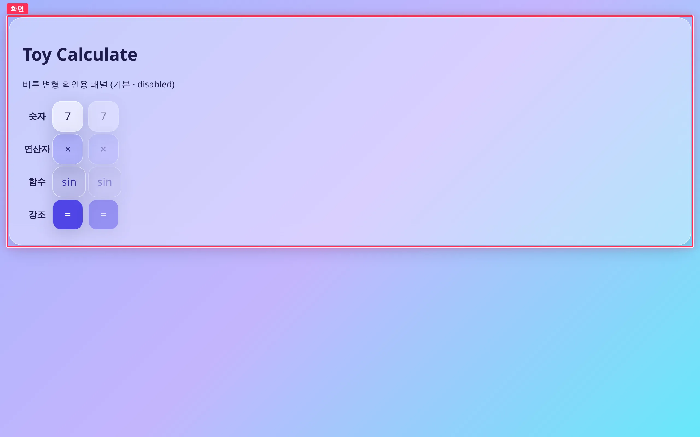 | 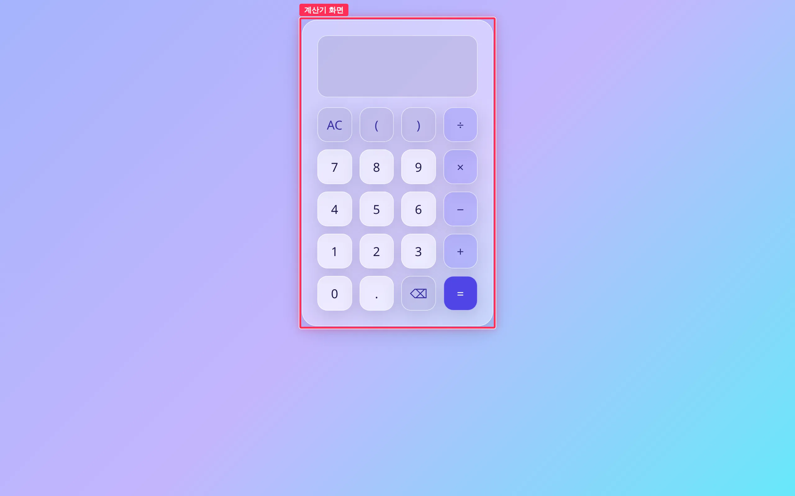 |
| 다크 1280 |  | 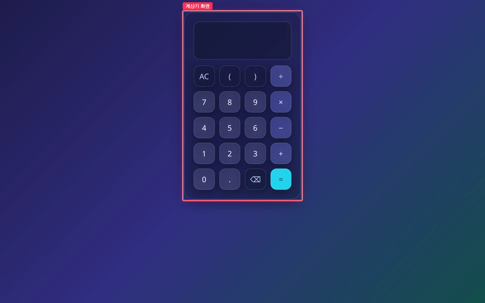 |

빨간 박스(`#app .glass`)가 변경 구간입니다. 전에는 버튼 변형 확인용 표, 후에는 계산기 화면입니다.

## 계산 결과 · 오류 표시 (1280px)

| 상태 | 전 | 후 |
| --- | --- | --- |
| 라이트 · `(2+3)×4 =` |  | 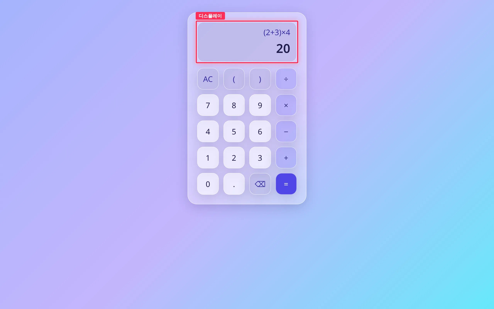 |
| 다크 · `(2+3)×4 =` | 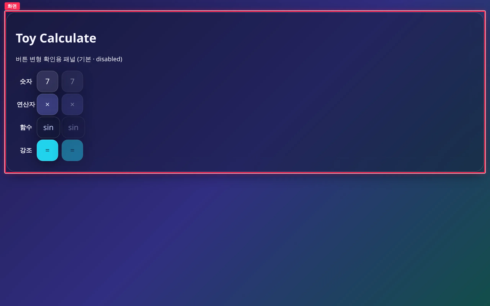 | 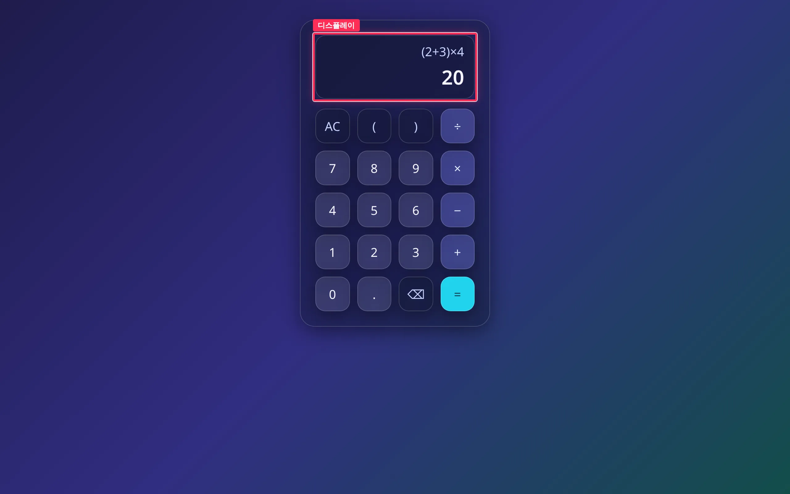 |
| 라이트 · `1÷0 =` |  | 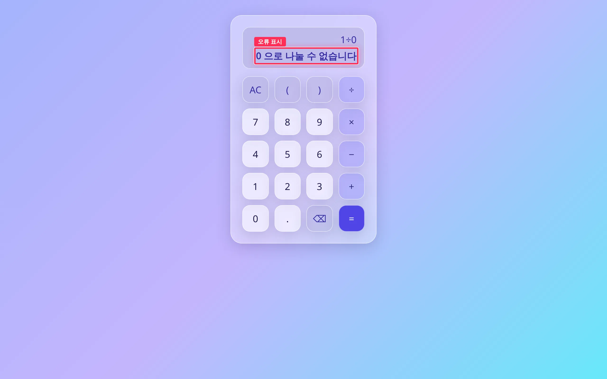 |
| 다크 · `1÷0 =` |  | 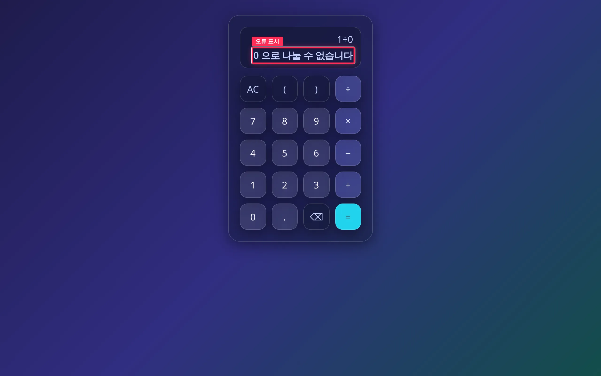 |

전에는 키패드가 없어 클릭할 대상이 없었으므로 기본 화면과 같고, 박스는 `#app .glass` 입니다. 후에는 결과 상태에서 `.calculator__display`(수식 `(2+3)×4` · 결과 `20`), 오류 상태에서 `.calculator__result`(`0 으로 나눌 수 없습니다`)에 박스를 그렸습니다.

360px 전후

| 모드 | 전 | 후 |
| --- | --- | --- |
| 라이트 | 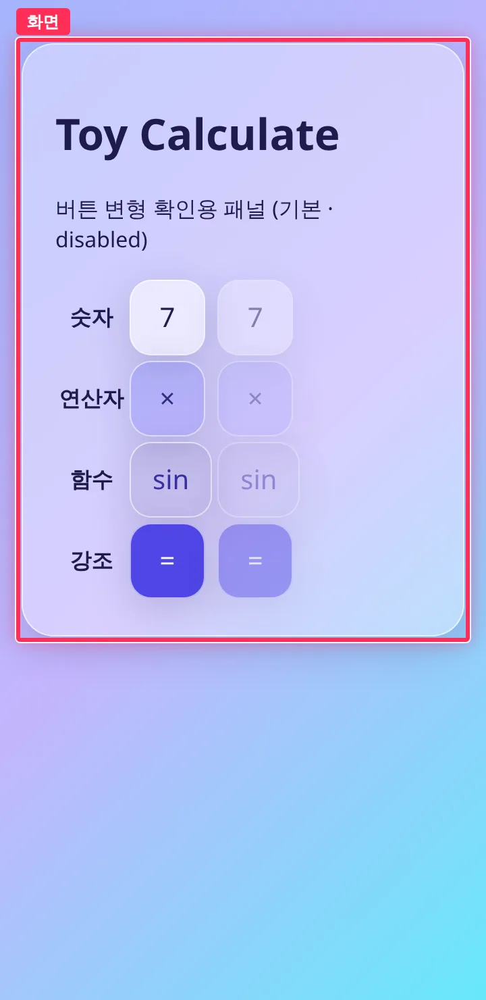 | 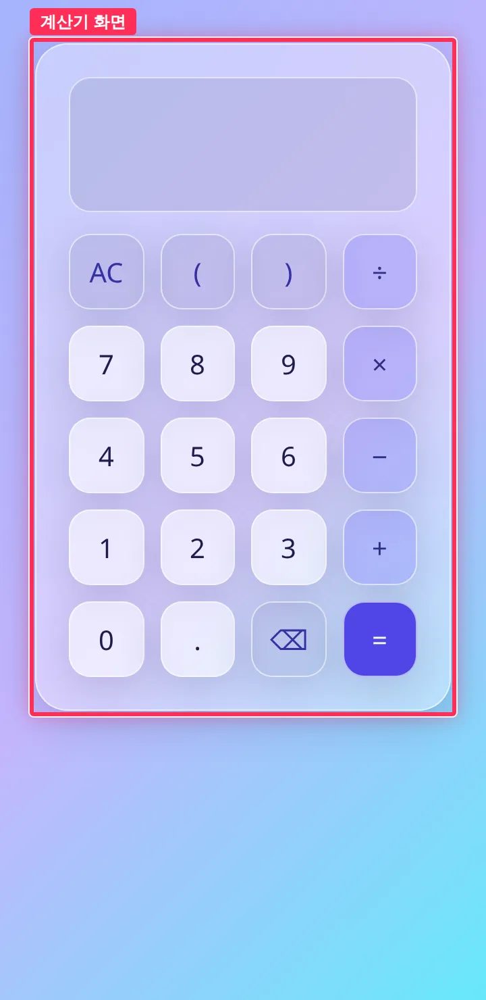 |
| 다크 | 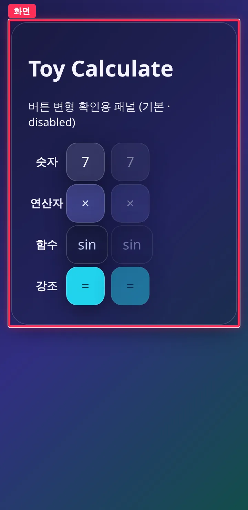 | 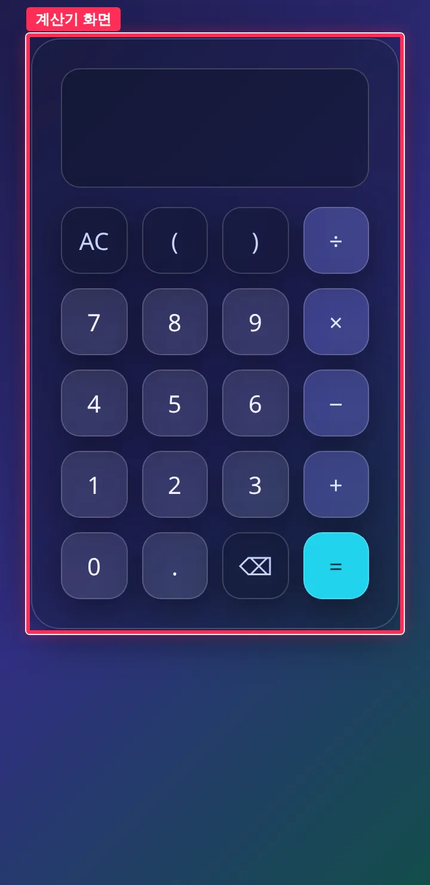 |

## 변경 파일

- `src/ui/input.ts` (신규) — 키 정의 `KEYS`(라벨·엔진 문자·버튼 변형), 상태 전이 `press`(입력 누적 · ⌫ · AC · =), 표시용 `formatExpression`
- `src/ui/input.test.ts` (신규) — 누적·삭제·초기화·평가·오류(0 나누기, 잘못된 수식, 빈 수식) 단위 테스트 13건
- `src/ui/calculator.ts` (신규) — 디스플레이·키패드 마운트, 클릭 이벤트 위임, `textContent` 로 갱신, 결과 줄 `aria-live`
- `src/ui/calculator.css` (신규) — 디스플레이·4열 키패드 레이아웃. 기존 토큰만 사용
- `src/main.ts` — 버튼 확인용 표를 `mountCalculator(app)` 으로 교체

## 검증

- `npm test` (138 passed) / `npm run typecheck` / `npm run build` 로컬 통과 — 출력: [verify.txt](https://github.com/Mineru98/toy-calculate/blob/main/.issue/7/evidence/after/verify.txt)
- Playwright 키패드 클릭(360x740): `(2+3)×4 =` → `20`, AC → 빈 화면, `12+` ⌫ → `12`, `12÷0 =` · `2+× =` · 빈 수식 `=` → 결과 줄 오류 표시, 360px 가로 넘침 없음 (verify.txt)
- 뷰포트 1280x800 · 360x740, 라이트·다크 (Playwright `colorScheme`)

## 남은 이슈

- 결과 표시 뒤 새 입력은 수식에 이어 붙이고 결과 줄만 비웁니다. 결과값을 다음 수식으로 이어받는 동작은 넣지 않았습니다.
- 결과는 `String(value)` 로 그대로 보여 줍니다(예: `0.1+0.2` → `0.30000000000000004`). 자릿수 정리는 범위 밖입니다.
- 엔진 오류 메시지에는 엔진 문자(`'*'`)가 그대로 나옵니다. 엔진 계약은 이번 이슈에서 바꾸지 않았습니다.
- 키보드 입력·공학용 키·반응형 다듬기는 후행 이슈(#8, #9, #11, #13) 범위입니다.
