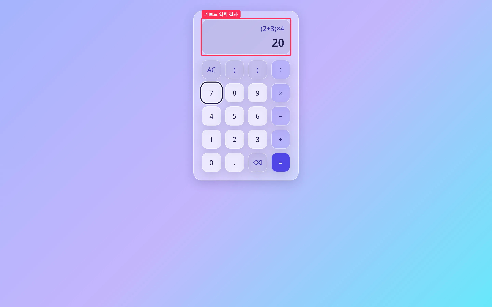
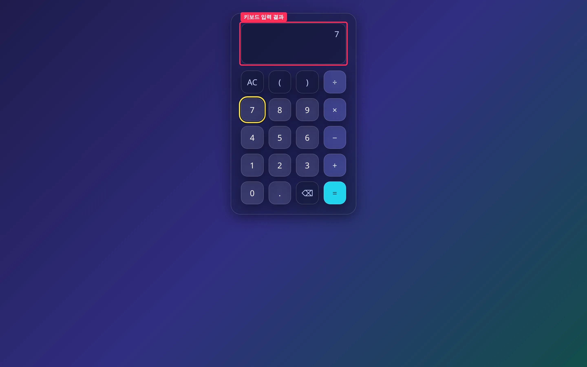
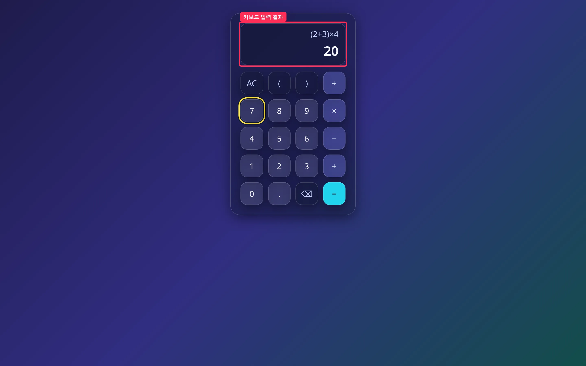
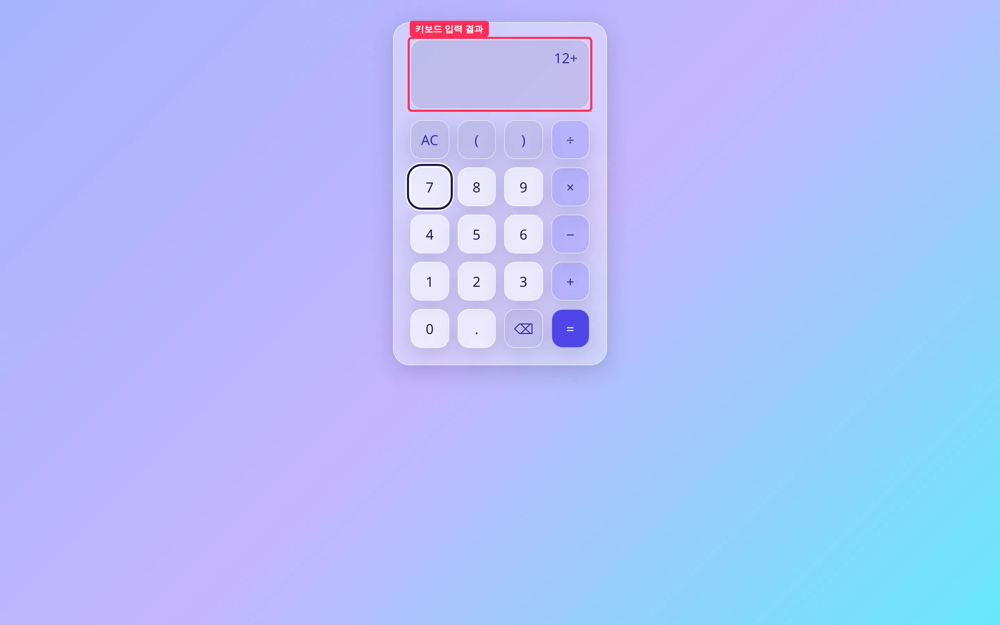

## 작업 요약

기본 화면(#7)을 키보드만으로 쓸 수 있게 했습니다. `0~9 . + - * / ( ) ^ % !` 는 그대로, Enter·`=` → =, Backspace → ⌫, Escape → AC 로 매핑해 키패드와 같은 `press` 를 탑니다.
처리한 키는 `preventDefault()` 해서, 키패드 버튼에 포커스가 있을 때 Enter 가 그 버튼을 한 번 더 누르던 문제(before 의 `7`)가 사라졌습니다. Ctrl/Meta/Alt 조합·IME 조합 중·입력 필드에서 온 키는 가로채지 않습니다.
#8(공학용 키)이 아직 merge 전이라 `^ % !` 는 이슈 본문대로 엔진이 받는 문자로 바로 입력합니다.

## 변경 전후 — 키보드로 `(2+3)*4` 입력 후 Enter (1440x900, `7` 버튼 포커스 상태)

| 모드 | 전 | 후 |
| --- | --- | --- |
| 라이트 |  |  |
| 다크 |  |  |

빨간 박스(`.calculator__display`)가 변경 구간입니다. 전에는 문자 키가 무시되고 Enter 가 포커스된 `7` 버튼을 눌러 수식이 `7` 이 됐고, 후에는 `(2+3)×4` · `20` 이 표시됩니다.

Backspace · Escape · ^ % ! 전후

| 키 입력 | 전 | 후 |
| --- | --- | --- |
| `12+3` Backspace |  |  |
| `12+3` Enter Escape |  |  |
| `3!+2^3+50%` Enter |  |  |

후: Backspace → `12+`, Escape → 빈 화면(AC 와 동일), `3!+2^3+50%` → `14.5`. 전에는 문자 키가 모두 무시돼 빈 화면이거나, Enter 가 포커스 버튼을 눌러 `7` 만 남았습니다.

## 변경 파일

- `src/ui/keyboard.ts` — 신규. `keyFromEvent`(키 → 입력 매핑), `isEditableTarget`(입력 필드 판별)
- `src/ui/calculator.ts` — `document` keydown 리스너: 매핑된 키만 `preventDefault` 후 `press`·렌더
- `src/ui/input.ts` — `InputKey = KeyId | '^' | '%' | '!'`, `press` 인자 타입 확장(기존 호출 호환)
- `src/ui/keyboard.test.ts` — 신규. 키 매핑·수정자 키 무시·`(2+3)*4` Enter → 20·Backspace/Escape = ⌫/AC·`^ % !` 계산

## 검증

- `npm test` — Test Files 3 passed, Tests 147 passed
- `npm run typecheck` — 통과
- `npm run build` — 통과
- 전체 출력: [`.issue/9/evidence/after/verify.txt`](https://github.com/Mineru98/toy-calculate/blob/main/.issue/9/evidence/after/verify.txt)
- 브라우저: Playwright 실제 `keyboard.press` 로 위 시나리오를 입력해 캡처(라이트·다크)

## 남은 이슈

- #8 이 merge 되면 `^ % !` 를 화면 버튼의 `KeyId` 로 옮기면 됩니다. 지금은 `InputKey` 로만 받습니다.
